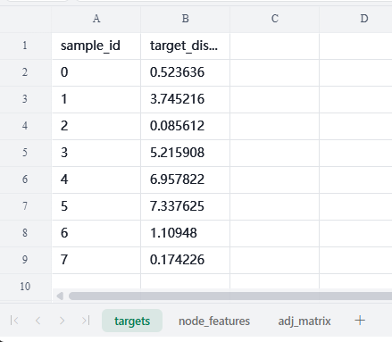
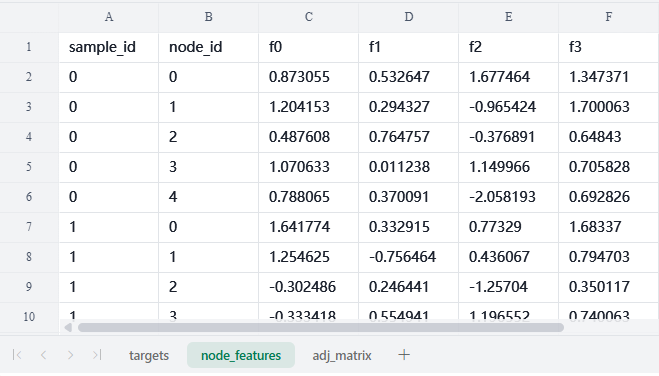
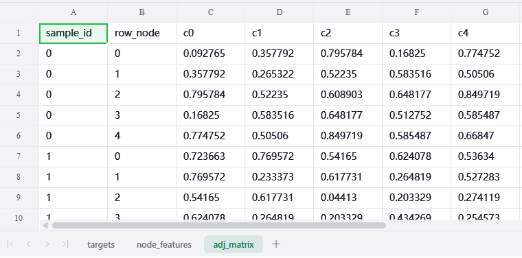
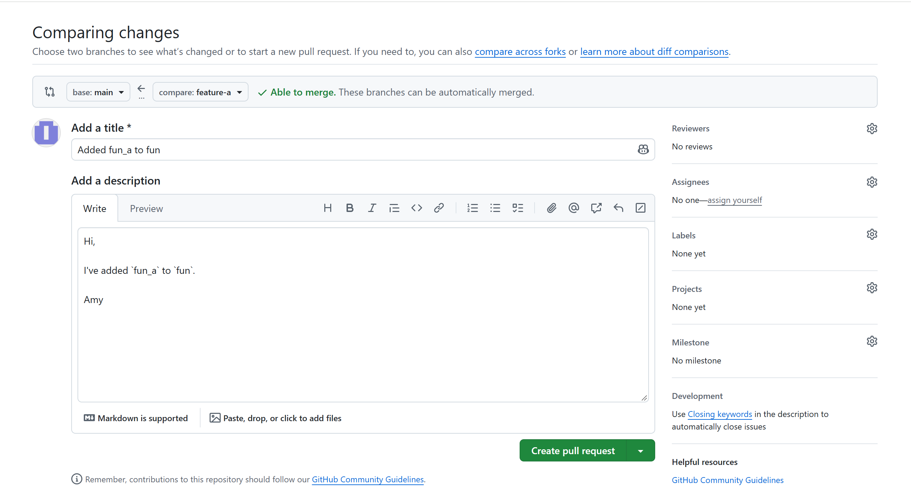
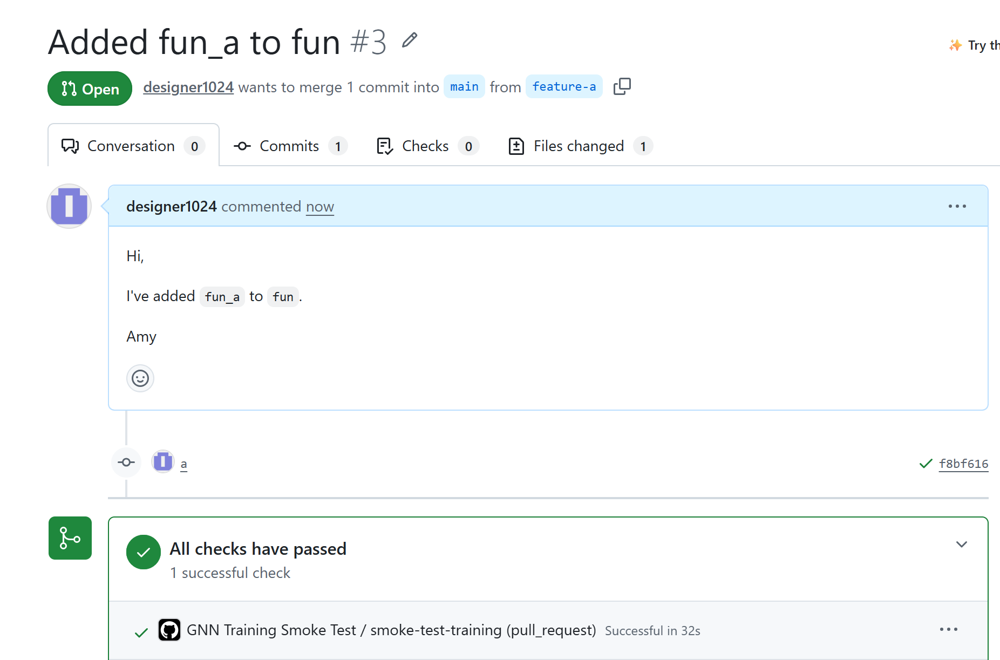
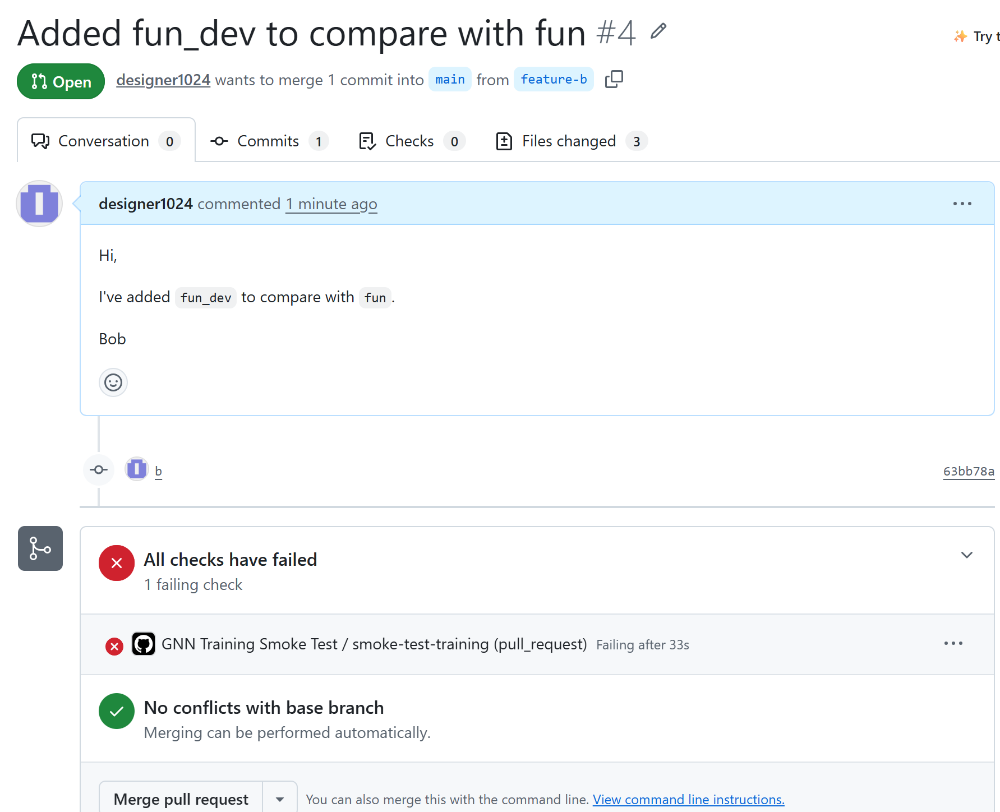
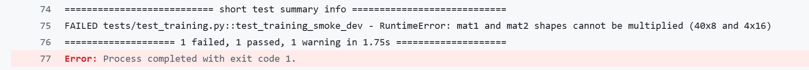

# GitHub Actions + pytest GNN Smoke Test Demo

A minimal demo showing how to run automated `pytest` smoke tests on a PyTorch Graph Neural Network (GNN) training pipeline using **GitHub Actions**.

---

## Background

### Branches

This repository consists of three branches demonstrating a typical collaborative research workflow:

* `main`: Baseline branch containing `fun` in `model.py`, representing the current stable implementation.
* `feature-a`: Feature branch A, where a nested method `fun_a` is called inside `fun`, representing an incremental enhancement to an existing component.
* `feature-b`: Feature branch B, where an experimental method `fun_dev` is added alongside `fun` (selected via an `option` parameter), representing a new variant proposed for comparison against the original implementation.

### Basic Setting

The demo model (`SimpleGNNRegressor` in `model.py`) solves a **graph-level distance regression** task:

- **Inputs**: For each graph in a batch, it takes a node feature matrix `node_features` of shape `[batch_size, num_nodes, in_features]` and an adjacency matrix `adj_matrix` of shape `[batch_size, num_nodes, num_nodes]` encoding graph connectivity and edge weights.
- **Output**: A single continuous scalar `pred_distance` of shape `[batch_size]`, representing the predicted graph-level distance.

All branches share the following project structure:

```text
github-actions-demo/
├── .github/
│   └── workflows/
│       └── ci.yml             # GitHub Actions CI workflow
├── data/
│   ├── load_data.py           # Excel graph dataset loader
│   ├── full_data.xlsx         # Larger dataset for normal training
│   └── smoke_data.xlsx        # Tiny dummy dataset for CI smoke tests
├── tests/
│   └── test_training.py       # pytest smoke test suite
├── model.py                   # GNN distance regression model
├── train.py                   # Training script
├── requirements.txt           # Full dependencies for local / GPU training
└── requirements-ci.txt        # Lightweight CPU-only dependencies for CI
```

---

## A Step-by-Step Guide to Building This Repository

### Environment

A deep learning project relies on external Python packages, and `requirements.txt` lists the dependencies required for local or GPU cluster development.

In this demo, `torch` is used for model building and training, `openpyxl` is used for loading Excel datasets, and `pytest` is used for automated testing:

```text
torch==2.4.1
openpyxl>=3.1.0
pytest>=8.0.0
```

To set up the local environment, create a new Python environment and run:

```bash
pip install -r requirements.txt
```

### Data

In this demo, we run `generate_data.py` to generate two synthetic Excel workbooks under `data/`:

* `data/full_data.xlsx`: Stores the larger dataset used for normal training (`python train.py`).
* `data/smoke_data.xlsx`: Stores a tiny dummy dataset (7 samples) used for fast `pytest` smoke tests in CI.

Each graph sample consists of 5 nodes, where each node has 4 features, paired with a 5 × 5 adjacency matrix representing edge connections/weights and a scalar `target_distance` label.







> In real practice, you can export a small mini-batch from your actual dataset as `smoke_data.xlsx` (or generate synthetic tensors of matching shapes) for the `pytest` smoke test.

### Model Architecture

In `model.py`, `SimpleGNNRegressor` performs a 4-step forward pass for graph-level distance regression:

1. **`torch.bmm(adj_matrix, node_features)`**: Aggregates neighboring node features according to the adjacency matrix.
2. **`self.relu(self.linear1(agg))`**: Projects aggregated node features into `hidden_dim` (16) dimensions with a ReLU nonlinearity.
3. **`h.mean(dim=1)`**: Averages node embeddings across each graph to produce a fixed-size graph representation `[batch_size, hidden_dim]`.
4. **`self.regressor(graph_emb).squeeze(-1)`**: Maps each graph embedding to a single continuous distance prediction `[batch_size]`.

```python
class SimpleGNNRegressor(nn.Module):
    def __init__(self, in_features: int, hidden_dim: int = 16):
        super().__init__()
        self.linear1 = nn.Linear(in_features, hidden_dim)
        self.relu = nn.ReLU()
        self.regressor = nn.Linear(hidden_dim, 1)

    def forward(self, node_features: torch.Tensor, adj_matrix: torch.Tensor) -> torch.Tensor:
        """
        node_features: [batch_size, num_nodes, in_features]
        adj_matrix:    [batch_size, num_nodes, num_nodes]
        """
        agg = torch.bmm(adj_matrix, node_features)

        agg = self.fun(agg)

        h = self.relu(self.linear1(agg))
        graph_emb = h.mean(dim=1)
        pred_distance = self.regressor(graph_emb)
        return pred_distance.squeeze(-1)
```

We also include `fun` as an extension point in `SimpleGNNRegressor` to demonstrate how collaborators modify or compare components in feature branches:

```python
    def fun(self, x: torch.Tensor) -> torch.Tensor:
        print("function is called")
        return x
```

### Training Procedure

In `train.py`, the dataset is loaded from `data/full_data.xlsx` via `load_graph_excel` and passed into `train(...)` for 100 epochs of MSE optimization:

```python
from pathlib import Path
import torch
import torch.nn as nn
from data.load_data import load_graph_excel
from model import SimpleGNNRegressor


def train(
    node_features: torch.Tensor,
    adj_matrix: torch.Tensor,
    target_distance: torch.Tensor,
    epochs: int = 100,
) -> float:
    in_features = node_features.shape[-1]
    model = SimpleGNNRegressor(in_features=in_features, hidden_dim=16)
    optimizer = torch.optim.Adam(model.parameters(), lr=1e-2)
    criterion = nn.MSELoss()

    model.train()
    for epoch in range(1, epochs + 1):
        optimizer.zero_grad()
        y_pred = model(node_features, adj_matrix)
        loss = criterion(y_pred, target_distance)
        loss.backward()
        optimizer.step()
        print(f"Epoch [{epoch}/{epochs}] - MSE Loss: {loss.item():.4f}")

    print("Training finished!")
    return loss.item()


if __name__ == "__main__":
    data_path = Path("data/full_data.xlsx")
    x, adj, y_true = load_graph_excel(data_path)
    train(x, adj, y_true, epochs=100)
```

For normal local or cluster training (using `data/full_data.xlsx`), run:

```bash
python train.py
```

---

## Setting Up GitHub Actions

Next, we automate a fast smoke test so GitHub runs `pytest` on every code change.

### CI Environment (`requirements-ci.txt`)

Standard GitHub Actions runners (`ubuntu-latest`) only provide CPUs—they do not have GPUs. To keep CI fast (typically a few seconds with pip caching), we create a lightweight `requirements-ci.txt` that installs the **CPU-only** build of PyTorch:

```text
--extra-index-url https://download.pytorch.org/whl/cpu
torch==2.4.1+cpu
openpyxl>=3.1.0
pytest>=8.0.0
```

### Smoke Test Code (`tests/test_training.py`)

`tests/test_training.py` reuses the exact same `train(...)` function from `train.py`, except it loads the tiny `data/smoke_data.xlsx` dataset and runs only **2 epochs** to verify end-to-end execution:

```python
from pathlib import Path
from data.load_data import load_graph_excel
from train import train


def test_training_smoke():
    """Load the small dummy Excel dataset and run 2 epochs to verify the training pipeline."""
    data_path = Path("data/smoke_data.xlsx")
    x, adj, y_true = load_graph_excel(data_path)
    final_loss = train(x, adj, y_true, epochs=2)
    assert final_loss >= 0.0
```

You can run the same smoke test locally with:

```bash
python -m pytest -v
```

### Workflow Configuration (`.github/workflows/ci.yml`)

Create `.github/workflows/ci.yml` to define the automation pipeline:

- **Triggers (`on: push / pull_request`)**: Automatically runs whenever changes to `*.py`, `requirements-ci.txt`, or `.github/workflows/ci.yml` are pushed to `main` or opened as a Pull Request targeting `main`.
- **Job (`smoke-test-training`)**: Checks out the repo on `ubuntu-latest`, sets up Python 3.11 with pip caching, installs `requirements-ci.txt`, and runs `python -m pytest -v` across all `tests/test_*.py` files.

---

## GitHub Actions for Collaboration

Consider a collaborative scenario with two developers:

- **Amy** is assigned to improve the existing `fun` method by nesting a new function `fun_a` inside it.
- **Bob** is assigned to propose a brand-new experimental method `fun_dev` and compare it against the original `fun`.

### Branch A (`feature-a` →  ✅)

Amy creates a feature branch `feature-a` from `main` and updates `fun` in `model.py` to call `fun_a`:

```python
    def fun(self, x: torch.Tensor) -> torch.Tensor:
        print("function is called")
        x = self.fun_a(x)
        return x

    def fun_a(self, x: torch.Tensor) -> torch.Tensor:
        print("function a is called")
        return x
```

Amy pushes `feature_a` to GitHub and opens a Pull Request targeting `main`:



GitHub Actions automatically runs `pytest`, and Amy's changes pass all checks with a green checkmark:



### Branch B (`feature_b` → ❌)

Bob creates another feature branch `feature_b` from `main` to add `fun_dev` and compare it with the original `fun`:

```python
    def fun_dev(self, x: torch.Tensor) -> torch.Tensor:
        # Intentionally introduce a bug that doubles the feature dimension (4 -> 8),
        # causing a shape mismatch error in the subsequent linear1(4, 16) layer
        print("fun_dev is called")
        return torch.cat([x, x], dim=-1)
```

Because `fun` and `fun_dev` are parallel alternatives, Bob adds an `option` parameter (`"org"` vs. `"dev"`) to `SimpleGNNRegressor` in `model.py`:

```python
class SimpleGNNRegressor(nn.Module):
    def __init__(self, in_features: int, hidden_dim: int = 16, option: str = "org"):
        super().__init__()
        self.linear1 = nn.Linear(in_features, hidden_dim)
        self.relu = nn.ReLU()
        self.regressor = nn.Linear(hidden_dim, 1)
        self.option = option

    def forward(self, node_features: torch.Tensor, adj_matrix: torch.Tensor) -> torch.Tensor:
        """
        node_features: [batch_size, num_nodes, in_features]
        adj_matrix:    [batch_size, num_nodes, num_nodes]
        """
        agg = torch.bmm(adj_matrix, node_features)

        if self.option == "org":
            agg = self.fun(agg)
        elif self.option == "dev":
            agg = self.fun_dev(agg)
        else:
            raise ValueError(f"Invalid option: {self.option}")

        h = self.relu(self.linear1(agg))
        graph_emb = h.mean(dim=1)
        pred_distance = self.regressor(graph_emb)
        return pred_distance.squeeze(-1)
```

He also updates `train.py` to pass `option="org"` by default:

```python
if __name__ == "__main__":
    data_path = Path("data/full_data.xlsx")
    x, adj, y_true = load_graph_excel(data_path)
    train(x, adj, y_true, epochs=100, option="org")
```

And in `tests/test_training.py`, he keeps the test for `"org"` and adds a new test for `"dev"`:

```python
from pathlib import Path
from data.load_data import load_graph_excel
from train import train


def test_training_smoke_org():
    """Load the small dummy Excel dataset and run 2 epochs to verify the training pipeline."""
    data_path = Path("data/smoke_data.xlsx")
    x, adj, y_true = load_graph_excel(data_path)
    final_loss = train(x, adj, y_true, epochs=2, option="org")
    assert final_loss >= 0.0


def test_training_smoke_dev():
    """Load the small dummy Excel dataset and run 2 epochs to verify the dev option."""
    data_path = Path("data/smoke_data.xlsx")
    x, adj, y_true = load_graph_excel(data_path)
    final_loss = train(x, adj, y_true, epochs=2, option="dev")
    assert final_loss >= 0.0
```

Bob pushes `feature-b` to GitHub and opens a Pull Request targeting `main`:



GitHub Actions catches the intentional bug in `fun_dev`: `test_training_smoke_org` passes, while `test_training_smoke_dev` fails with a `RuntimeError` due to the tensor dimension mismatch (`8` vs. `4` input features in `linear1`), blocking the broken code before it can be merged into `main`:


